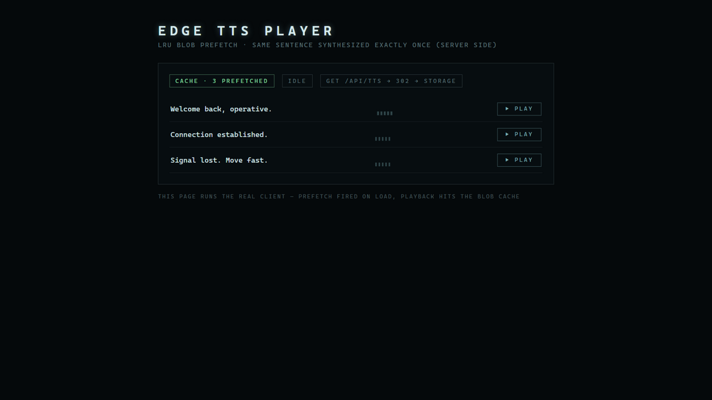

<div align="center">

# edge-tts-pipeline

**Production-grade free TTS: EdgeTTS synthesis behind a content-addressed cache, plus an LRU-prefetching client player. The same sentence is synthesized exactly once.**

[](./LICENSE)
[](./.github/workflows/ci.yml)

[中文文档](./README.zh-CN.md)

</div>

---

`msedge-tts` gives you free Microsoft neural voices — but synthesizing on
every request is slow, flaky, and wasteful. This pipeline turns it into an
infrastructure component:

- **Server**: `sha1(voice:text)` → cache index → hit: 302 the client straight
  to stored audio; miss: synthesize → upload → index. Storage and cache are
  adapters — bring Supabase, S3, local FS, anything.
- **Client**: singleton player + session-memory LRU blob prefetch. Prefetch a
  batch of texts you know you'll need and playback lands at ~0ms.
- **Batch tooling**: pre-generate your whole corpus offline with the same
  pipeline (see `examples/pregen.mjs` sketch below).
<div align="center">
  
</div>


```ts
// app/api/tts/route.ts  (Next.js App Router)
import { createTtsRoute, createEdgeTtsSynth, createMemoryAdapters } from "edge-tts-pipeline/server";

export const GET = createTtsRoute({
  ...createMemoryAdapters(), // swap for createSupabaseAdapters(...) in production
  synth: createEdgeTtsSynth(),
  defaultVoice: "en-US-AriaNeural",
});
```

## Features

- **Content-addressed cache** — the same sentence is synthesized exactly once per deployment; the index is global and carries no user data.
- **Adapter-based** — `StorageAdapter` / `CacheAdapter` / `SynthAdapter` interfaces; memory adapters included, Supabase + EdgeTTS as reference implementations.
- **Client LRU prefetch** — bounded-concurrency prefetch into an object-URL cache, LRU eviction, recency refresh on hit.
- **Global playback state** — pub/sub `subscribe()` for waveform animations and play/pause UI.
- **Optional peers only** — `msedge-tts` and `@supabase/supabase-js` are optional peer dependencies; code paths for them load only if you import them.

## Install

```bash
npm install edge-tts-pipeline
npm install msedge-tts          # server synth (optional peer)
npm install @supabase/supabase-js  # Supabase adapters (optional peer)
```

| Part | Import |
| --- | --- |
| Route factory + adapters | `"edge-tts-pipeline/server"` |
| Player + prefetch | `"edge-tts-pipeline/client"` |

## Server usage

```ts
// Next.js App Router — app/api/tts/route.ts
import {
  createTtsRoute,
  createEdgeTtsSynth,
  createSupabaseAdapters,
} from "edge-tts-pipeline/server";
import { createClient } from "@supabase/supabase-js";

const supabase = createClient(process.env.SUPABASE_URL!, process.env.SUPABASE_SERVICE_KEY!);

export const GET = createTtsRoute({
  ...createSupabaseAdapters({
    client: supabase,
    bucket: "tts-audio",
    publicBaseUrl: process.env.SUPABASE_URL!,
  }),
  synth: createEdgeTtsSynth(),
  defaultVoice: "en-US-AriaNeural",
});
```

The route answers `GET /api/tts?text=...&voice=...` with a 302 to the stored
audio. Cache table SQL is documented in
[`src/server/adapters/supabase.ts`](./src/server/adapters/supabase.ts).

## Client usage

```ts
import { createTtsClient } from "edge-tts-pipeline/client";

const tts = createTtsClient({ endpoint: "/api/tts" });

// You know the texts before the user clicks — prefetch them:
tts.prefetch(["Welcome back.", "Connection established.", "Signal lost."]);

tts.speak("Welcome back.", () => console.log("done"));
tts.subscribe((playing) => animateWaveform(playing));
```

### Batch pre-generation

```js
// examples sketch — run with tsx/node
import { ensureTts, createMemoryAdapters } from "edge-tts-pipeline/server";
const texts = loadCorpus();
for (const text of texts) {
  await ensureTts(pipeline, text, "en-US-AriaNeural"); // caches; 2nd run is a no-op
}
```

## Notes & limits

- `msedge-tts` uses undocumented Microsoft endpoints — treat it as best-effort
  free tier and keep the `SynthAdapter` seam so you can swap in Azure/Google
  without touching the pipeline.
- Cache and storage hold no user data (voice + text only) — keep it that way
  if you add analytics.

## Origin

Extracted from the HackerEnglish project, where it voices the entire learning
corpus on a zero TTS budget. See [`docs/PORTING.md`](./docs/PORTING.md).

## License

[MIT](./LICENSE).
